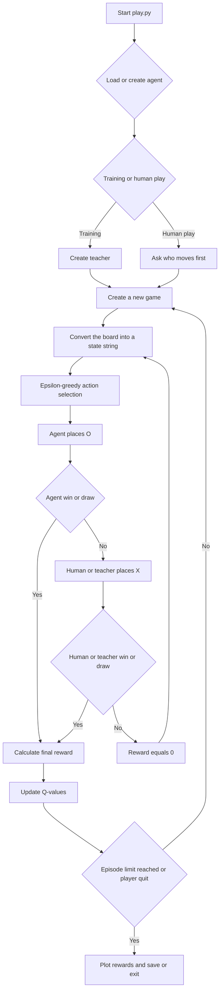

# AI Tic-Tac-Toe using Reinforcement Learning

A 3×3 Tic-Tac-Toe project that uses reinforcement learning to train an agent
to play against a human or an automated teacher.

The project implements Q-learning and SARSA. Q-learning is the recommended
algorithm for the semester demonstration because it is easier to explain,
train, and test.

## Project Information

| Item | Details |
|---|---|
| Project | AI Tic-Tac-Toe using Reinforcement Learning |
| Project owner and author | SAIR ZEESHAN |
| Programming language | Python |
| Algorithms | Q-learning |
| Recommended demonstration | Q-learning |
| License | MIT |

The original MIT-licensed source code is preserved with its attribution.
This semester project and its optimized implementation are owned and
documented by SAIR ZEESHAN.

## Project Files

```text
AI-Tic-Tac-Toe/
|-- play.py                  Command-line entry point
|-- tictactoe/
|   |-- agent.py             Learner and Q-table implementation
|   |-- game.py              Board, turns, rules, and episode handling
|   `-- teacher.py           Automated training opponent
|-- tests/
|   `-- test_project.py      Unit tests
|-- trained_agents/
|   `-- qlearner_agent.pkl   Saved and trained Q-learning agent
|-- FINAL_REPORT.docx        Semester-project report
|-- README.md
|-- .gitignore
`-- LICENSE
```

## How It Works



## Important Code Sections

The following code sections are the main parts of the reinforcement-learning
implementation. They control learning, moves, rewards, training, and game
rules.

### 1. Command-Line Entry Point

[`play.py`](play.py) is the starting point of the project. It reads command-line
options and decides whether to create or load an agent:

```python
parser.add_argument("-a", "--agent_type", type=str, default="q")
parser.add_argument("-l", "--load", action="store_true")
parser.add_argument("-t", "--teacher_episodes", default=None, type=int)
```

- `-a q` selects the Q-learning agent.
- `-l` loads the previously saved model.
- `-t 5000` trains the agent for 5000 episodes.
- No `-t` option starts human-versus-agent play.

This file connects the command-line interface with the game and learning
components.

### 2. State and Valid Action Selection

[`tictactoe/agent.py`](tictactoe/agent.py) converts the board into valid moves
before the agent chooses an action:

```python
possible_actions = [
    action for action in self.actions
    if state[action[0] * 3 + action[1]] == '-'
]
```

A state is a nine-character board string such as `"OX---O--X-"`. An action is
a `(row, column)` position. This code prevents the agent from choosing an
occupied square.

### 3. Epsilon-Greedy Selection

The same file chooses whether to explore or exploit learned knowledge:

```python
if random.random() < self.eps:
    action = random.choice(possible_actions)
else:
    max_value = max(self.Q[action][state] for action in possible_actions)
    best_actions = [
        action for action in possible_actions
        if self.Q[action][state] == max_value
    ]
    action = random.choice(best_actions)
```

With the default epsilon of `0.1`, the agent explores by taking a random valid
move 10 percent of the time. Otherwise, it selects a move with the highest
learned Q-value. This balances new moves with the agent's existing knowledge.

### 4. Q-Learning Update

The `update()` method in [`tictactoe/agent.py`](tictactoe/agent.py) is the
main learning operation:

```python
if next_state is not None:
    possible_actions = [
        action for action in self.actions
        if next_state[action[0] * 3 + action[1]] == '-'
    ]
    target = reward + self.gamma * max(
        self.Q[action][next_state]
        for action in possible_actions
    )
else:
    target = reward

self.Q[action][state] += self.alpha * (
    target - self.Q[action][state]
)
```

This formula updates `Q(state, action)` using the reward and the estimated
value of the next state. A win receives `+1`, a loss receives `-1`, and a draw
receives `0`. Better moves gradually receive higher Q-values.

### 5. Game Loop and Reward Calculation

[`tictactoe/game.py`](tictactoe/game.py) runs each episode. It applies the
agent move, checks for a terminal result, allows the opponent to move, and
calculates the intermediate reward:

```python
self.agentMove(previous_action)
check = self.checkForEnd('O')

if check != -1:
    reward = check
    break

self.playerMove()
check = self.checkForEnd('X')

if check != -1:
    reward = -1 * check
    break

reward = 0
new_state = getStateKey(self.board)
new_action = self.agent.get_action(new_state)
self.agent.update(
    previous_state,
    new_state,
    previous_action,
    new_action,
    reward
)
```

This loop creates the state, action, reward, and next-state information needed
by Q-learning.

### 6. Win and Draw Detection

The optimized win check in [`tictactoe/game.py`](tictactoe/game.py) compares
all eight possible winning lines:

```python
WIN_LINES = (
    ((0, 0), (0, 1), (0, 2)),
    ((1, 0), (1, 1), (1, 2)),
    ((2, 0), (2, 1), (2, 2)),
    ((0, 0), (1, 0), (2, 0)),
    ((0, 1), (1, 1), (2, 1)),
    ((0, 2), (1, 2), (2, 2)),
    ((0, 0), (1, 1), (2, 2)),
    ((0, 2), (1, 1), (2, 0)),
)
```

The game ends when all three positions in a line contain the same player token.
The draw check returns true when no empty square remains.

### 7. Automated Teacher

[`tictactoe/teacher.py`](tictactoe/teacher.py) trains the agent by selecting
X moves:

```python
if random.random() > self.ability_level:
    return self.randomMove(board)

return (
    self.win(board)
    or self.blockWin(board)
    or self.fork(board)
    or self.blockFork(board)
    or self.center(board)
    or self.corner(board)
    or self.sideEmpty(board)
    or self.randomMove(board)
)
```

The teacher follows a priority strategy: win, block, create or block a fork,
take the center or corner, take a side, and otherwise choose randomly. It also
uses a 10-percent random-move probability so training includes varied results.

These sections are the core of the project because they define the complete
learning cycle: observe a state, choose an action, play, receive a reward,
update the Q-table, and repeat.

### State

The 3×3 board is converted into a nine-character string. `-` represents an
empty square, `X` represents the player or teacher, and `O` represents the
computer agent.

For example:

```text
O X -
- O -
X - -
```

is represented as:

```text
"OX---O--X-"
```

### Action

An action is a `(row, column)` pair, such as `(1, 2)`. The agent considers
only squares whose board position contains `-`.

### Epsilon-greedy selection

The agent uses an epsilon-greedy policy:

- Choose a random valid move with probability `epsilon`
- Choose the move with the largest Q-value otherwise
- If multiple moves have the largest value, choose randomly among them

The default values are:

```text
alpha = 0.5
gamma = 0.9
epsilon = 0.1
```

## Q-learning Update

For a non-terminal state:

```text
Q(s,a) = Q(s,a) + alpha * (
    reward + gamma * max(Q(s',a')) - Q(s,a)
)
```

For a terminal state:

```text
Q(s,a) = Q(s,a) + alpha * (reward - Q(s,a))
```

The rewards used in the game are:

```text
Agent wins:  +1
Draw:         0
Agent loses: -1
```

The Q-learning update is in `tictactoe/agent.py`. The game loop is in
`tictactoe/game.py`, and the automated training opponent is in
`tictactoe/teacher.py`.

## Requirements

Python 3.10 or newer is recommended.

Install the packages used by the current source code:

```text
pip install matplotlib
```

NumPy is not required for the optimized Q-learning implementation. Action
selection, Q-table updates, win detection, and cumulative reward plotting use
Python lists, standard-library functions, and Matplotlib.

Run commands from the project directory.

## Installation

```text
git clone https://github.com/sairshiekh1725/AI-Tic-Tac-Toe.git
cd AI-Tic-Tac-Toe
pip install matplotlib
```

## Training

Initialize a new Q-learning agent and train it for 5000 episodes:

```text
python play.py -a q -t 5000
```

Load the saved Q-learning agent and train it for another 5000 episodes:

```text
python play.py -a q -l -t 5000
```

Training data is saved as a Pickle file in:

```text
trained_agents/qlearner_agent.pkl
```

The training process prints progress every 1000 episodes and displays the
cumulative reward chart after training.

The project currently creates `trained_agents/` automatically before saving
the agent.

## Human Play

Load a trained Q-learning agent and play against it:

```text
python play.py -a q -l
```

Enter a move as `row,column`, where both values range from `0` to `2`.

For example:

```text
Your move! Please select a row and column:
1,2
```

## Teacher Strategy

The teacher is not the learner. It follows a hierarchy of useful moves:

1. Win if possible
2. Block the agent from winning
3. Create or block a fork
4. Take the center
5. Take a corner
6. Take an empty side
7. Use a random empty square

The teacher makes a random move with probability `0.1` because its default
ability level is `0.9`. This variation helps the learner encounter wins,
losses, and draws.

## Testing

Run the automated test suite from the project directory:

```text
python -m unittest discover -s tests -v
```

The tests cover terminal Q-learning updates, model saving and loading, row
and diagonal wins, draw detection, state-key conversion, and immediate teacher
wins.

## Optimizations

The optimized implementation includes:

- Python-based epsilon-greedy action selection instead of NumPy
- `itertools.accumulate()` for cumulative reward plotting
- a shared set of eight precomputed win lines
- simpler draw and board-state conversion
- robust `row,column` human input validation
- automatic creation of the model-save directory
- focused unit tests

## Semester Project Summary

The project demonstrates:

- Reinforcement-learning states and actions
- Exploration and exploitation
- The Q-learning Bellman update
- Episode-based training
- Reward-based improvement
- Model serialization and loading
- Human-versus-agent gameplay

The complete Tic-Tac-Toe state space is small, so Q-learning can be trained
quickly and the learned policy can be saved for later use.
