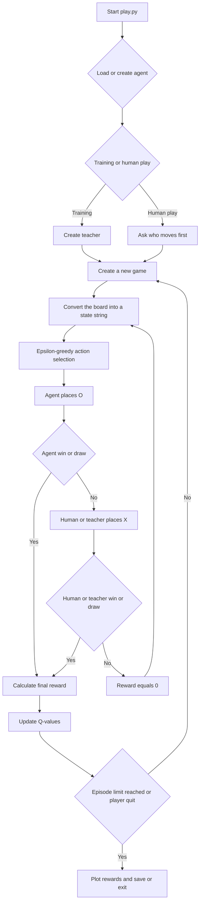

# AI Tic-Tac-Toe using Reinforcement Learning

A 3×3 Tic-Tac-Toe project that uses reinforcement learning to train an agent
to play against a human or an automated teacher.

The project implements Q-learning and SARSA. Q-learning is the recommended
algorithm for the semester demonstration because it is easier to explain,
train, and test.

## Project Information

| Item | Details |
|---|---|
| Project | AI Tic-Tac-Toe using Reinforcement Learning |
| Project owner and author | SAIR ZEESHAN |
| Original code source | Muskan Paliwal |
| Programming language | Python |
| Algorithms | Q-learning and SARSA |
| Recommended demonstration | Q-learning |
| License | MIT |

The original MIT-licensed source code is preserved with its attribution.
This semester project and its optimized implementation are owned and
documented by SAIR ZEESHAN.

## Project Files

```text
AI-Tic-Tac-Toe/
|-- play.py                  Command-line entry point
|-- tictactoe/
|   |-- agent.py             Learner and Q-table implementation
|   |-- game.py              Board, turns, rules, and episode handling
|   `-- teacher.py           Automated training opponent
|-- tests/
|   `-- test_project.py      Unit tests
|-- trained_agents/
|   `-- qlearner_agent.pkl   Saved and trained Q-learning agent
|-- FINAL_REPORT.docx        Semester-project report
|-- README.md
|-- .gitignore
`-- LICENSE
```

## How It Works



### State

The 3×3 board is converted into a nine-character string. `-` represents an
empty square, `X` represents the player or teacher, and `O` represents the
computer agent.

For example:

```text
O X -
- O -
X - -
```

is represented as:

```text
"OX---O--X-"
```

### Action

An action is a `(row, column)` pair, such as `(1, 2)`. The agent considers
only squares whose board position contains `-`.

### Epsilon-greedy selection

The agent uses an epsilon-greedy policy:

- Choose a random valid move with probability `epsilon`
- Choose the move with the largest Q-value otherwise
- If multiple moves have the largest value, choose randomly among them

The default values are:

```text
alpha = 0.5
gamma = 0.9
epsilon = 0.1
```

## Q-learning Update

For a non-terminal state:

```text
Q(s,a) = Q(s,a) + alpha * (
    reward + gamma * max(Q(s',a')) - Q(s,a)
)
```

For a terminal state:

```text
Q(s,a) = Q(s,a) + alpha * (reward - Q(s,a))
```

The rewards used in the game are:

```text
Agent wins:  +1
Draw:         0
Agent loses: -1
```

The Q-learning update is in `tictactoe/agent.py`. The game loop is in
`tictactoe/game.py`, and the automated training opponent is in
`tictactoe/teacher.py`.

## Requirements

Python 3.10 or newer is recommended.

Install the packages used by the current source code:

```text
pip install matplotlib
```

NumPy is not required for the optimized Q-learning implementation. Action
selection, Q-table updates, win detection, and cumulative reward plotting use
Python lists, standard-library functions, and Matplotlib.

Run commands from the project directory.

## Installation

```text
git clone https://github.com/sairshiekh1725/AI-Tic-Tac-Toe.git
cd AI-Tic-Tac-Toe
pip install matplotlib
```

## Training

Initialize a new Q-learning agent and train it for 5000 episodes:

```text
python play.py -a q -t 5000
```

Load the saved Q-learning agent and train it for another 5000 episodes:

```text
python play.py -a q -l -t 5000
```

Training data is saved as a Pickle file in:

```text
trained_agents/qlearner_agent.pkl
```

The training process prints progress every 1000 episodes and displays the
cumulative reward chart after training.

The project currently creates `trained_agents/` automatically before saving
the agent.

## Human Play

Load a trained Q-learning agent and play against it:

```text
python play.py -a q -l
```

Enter a move as `row,column`, where both values range from `0` to `2`.

For example:

```text
Your move! Please select a row and column:
1,2
```

## Teacher Strategy

The teacher is not the learner. It follows a hierarchy of useful moves:

1. Win if possible
2. Block the agent from winning
3. Create or block a fork
4. Take the center
5. Take a corner
6. Take an empty side
7. Use a random empty square

The teacher makes a random move with probability `0.1` because its default
ability level is `0.9`. This variation helps the learner encounter wins,
losses, and draws.

## Testing

Run the automated test suite from the project directory:

```text
python -m unittest discover -s tests -v
```

The tests cover terminal Q-learning updates, model saving and loading, row
and diagonal wins, draw detection, state-key conversion, and immediate teacher
wins.

## Optimizations

The optimized implementation includes:

- Python-based epsilon-greedy action selection instead of NumPy
- `itertools.accumulate()` for cumulative reward plotting
- a shared set of eight precomputed win lines
- simpler draw and board-state conversion
- robust `row,column` human input validation
- automatic creation of the model-save directory
- focused unit tests

The complete semester-project report is available in
[FINAL_REPORT.docx](/D:/cep/AI-Tic-Tac-Toe/FINAL_REPORT.docx).

## Semester Project Summary

The project demonstrates:

- Reinforcement-learning states and actions
- Exploration and exploitation
- The Q-learning Bellman update
- Episode-based training
- Reward-based improvement
- Model serialization and loading
- Human-versus-agent gameplay

The complete Tic-Tac-Toe state space is small, so Q-learning can be trained
quickly and the learned policy can be saved for later use.

## Authors and Ownership

- **Project owner and author:** SAIR ZEESHAN
- **Original source attribution:** Muskan Paliwal
- **Original repository:** https://github.com/MuskanPaliwal/AI-Tic-Tac-Toe

The original MIT license remains applicable to the source code derived from
the original repository. The semester-project implementation and report belong
to SAIR ZEESHAN.
